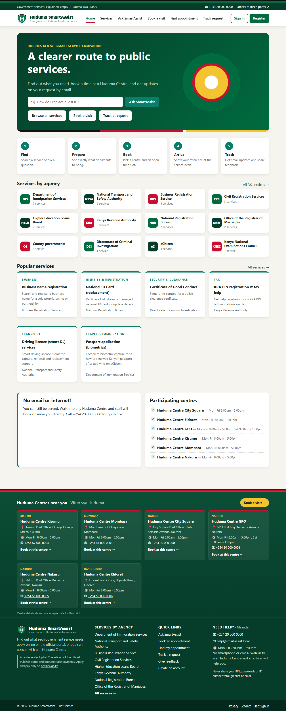
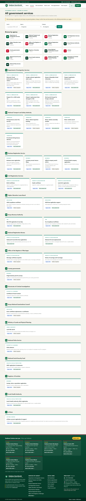

<div align="center">


# Huduma SmartAssist

**Government services, explained simply · _Huduma kwa urahisi_**

A web platform that helps citizens find Huduma Centre services, book an appointment for a specific day and time, and follow their request until it is complete. Staff get the tools to manage it all.


</div>

---

## Table of contents

- [Overview](#overview)
- [Screenshots](#screenshots)
- [Features](#features)
- [How it works](#how-it-works)
- [Tech stack](#tech-stack)
- [Project structure](#project-structure)
- [Getting started](#getting-started)
- [Configuration](#configuration)
- [Scheduled tasks](#scheduled-tasks)
- [Database](#database)
- [Security and privacy](#security-and-privacy)
- [Roadmap](#roadmap)
- [Disclaimer](#disclaimer)
- [Author](#author)
- [License](#license)

## Overview

Huduma Centres bring many government agencies under one roof. Citizens often arrive without knowing which documents to bring, queue for hours, or have no idea how far their application has progressed. **Huduma SmartAssist** is an independent pilot that tackles these problems:

1. **Find:** search 36 services from 17 agencies, or ask the SmartAssist assistant a question in English or Swahili.
2. **Prepare:** every service lists its requirements, steps, fees and processing time.
3. **Book:** choose a participating centre and an open time slot, so visits are spread across the day.
4. **Arrive:** show your booking reference at the service desk.
5. **Track:** get email updates as staff move your request forward, then rate the service.

Citizens without email or internet can still walk in. Staff can create an *assisted booking* for them at the desk.

## Screenshots

| Home | Services catalogue |
|---|---|
|  |  |

## Features

### For citizens
- **Service catalogue:** browse by agency or category, with full-text search, requirements, steps, fees and links to the official eCitizen portal.
- **SmartAssist assistant:** a question-answering assistant grounded *only* in the approved service catalogue and FAQs. It understands common Swahili and informal terms (*kitambulisho*, *pasipoti*, *leseni*, *miadi*…).
- **Online booking:** pick a centre and a time slot within a configurable booking window, with a cut-off before each slot.
- **Manage a booking:** view, cancel or reschedule through a secure tokenised link, with no password needed.
- **Request tracking:** a status timeline for each service request, using a reference number or tracking link.
- **Citizen accounts (optional):** see all your bookings and requests in one place.
- **Feedback:** rate your visit after it is completed.
- **Email notifications:** booking confirmations, reminders the day before, cancellations and status changes.

### For Huduma Centre staff
- **Dashboard:** today's slots, demand against capacity for the next 7 days, and requests needing follow-up, limited to the officer's own centre.
- **Appointments and check-in:** mark visitors as attended or as no-shows.
- **Assisted booking:** book on behalf of walk-in citizens who have no email or phone.
- **Service requests:** update status with notes; each change emails the citizen.
- **Slot management:** generate time slots in bulk (days, hours, interval and capacity).

### For administrators
- Manage **centres, services, FAQs and staff users**, with role-based access (`admin` / `staff`).
- **SmartAssist insights:** content gaps (questions the assistant could not answer well), the most asked-about services and recent questions, to guide content updates.
- **Citizen feedback:** ratings by service and recent comments.
- **Email outbox:** inspect and retry queued messages.
- **Audit log** of staff actions.

## How it works

```
Citizen ──► Services / Ask SmartAssist ──► Book a slot ──► Email confirmation
                                                │
                                                ▼
Staff  ◄── Dashboard ◄── Check-in at centre ◄── Appointment
  │
  └─► Update service request ──► Email update ──► Citizen tracks status ──► Feedback
```

**The assistant pipeline** ([`includes/assistant.php`](includes/assistant.php)):
1. Tokenise the question (stop words, Swahili synonyms, simple stemming) and rank the approved services and FAQs.
2. If the Anthropic PHP SDK and an API key are configured, Claude writes the answer using **only** the approved catalogue, which is sent as a cached system prompt.
3. Otherwise, or if the API call fails, the answer is built directly from the best catalogue match. **The site works fully without AI.**
4. Email addresses and long numbers (ID, phone and similar) are redacted before questions are logged.

## Tech stack

| Layer | Technology |
|---|---|
| Backend | PHP 8.1+ (no framework; PDO, strict types) |
| Database | MySQL 5.7+ / MariaDB 10.4+ (utf8mb4) |
| Web server | Apache with `.htaccess` (XAMPP for local development) |
| Frontend | Server-rendered HTML, custom CSS, vanilla JavaScript |
| AI (optional) | Anthropic Claude via `anthropic-ai/sdk` (Composer) |
| Email | Built-in SMTP client, PHP `mail()`, or log-to-disk |

## Project structure

```
huduma-smartassist/
├── index.php, services.php, service.php   # Public pages: home, catalogue, service detail
├── assistant.php                          # Ask SmartAssist
├── book.php, booking.php                  # Book and manage an appointment
├── track.php, feedback.php, privacy.php   # Request tracking, ratings, privacy notice
├── account/                               # Citizen register / login / dashboard
├── staff/                                 # Staff and admin back office
├── api/                                   # JSON endpoints for the assistant
├── includes/                              # Bootstrap, DB, auth, booking, mailer, assistant, layout
├── database/                              # schema.sql, seed data, eCitizen catalogue, migrations
├── install/install.php                    # One-time installer (web or CLI)
├── cron/run.php                           # Reminders, no-shows, email queue, cleanup
├── assets/                                # CSS, JS, logo
├── storage/                               # Mail and log output (git-ignored)
├── docs/screenshots/                      # README images
├── generate_deck.js                       # Builds the evaluation slide deck (PptxGenJS)
└── Huduma_SmartAssist_Evaluation_Presentation.pptx
```

## Getting started

### Prerequisites
- [XAMPP](https://www.apachefriends.org/) (or any Apache + PHP 8.1+ + MySQL/MariaDB stack)
- PHP extensions: `pdo_mysql`, `mbstring`, `openssl`
- *(Optional)* [Composer](https://getcomposer.org/), for AI answers

### 1. Clone into your web root

```bash
cd C:/xampp/htdocs            # or /var/www/html
git clone https://github.com/Robatech348/Huduma-smart-assit.git "huduma smart assist"
cd "huduma smart assist"
```

### 2. Configure

```bash
cp config.sample.php config.php
```

Edit `config.php` and set `app.url` to the public URL of the folder and `db.*` to your MySQL credentials. See [Configuration](#configuration).

### 3. Start Apache and MySQL, then install

**In the browser:** open `http://localhost/huduma%20smart%20assist/install/install.php` and create the first administrator.

**Or from the command line:**

```bash
php install/install.php admin@example.org "AStrongPassword1" "Admin Name"
```

The installer creates the database and tables. It loads sample centres, services and FAQs, generates three weeks of time slots, and creates a demo staff account. The demo password is printed once.

### 4. Open the app

| Area | URL |
|---|---|
| Public site | `http://localhost/huduma%20smart%20assist/` |
| Staff sign-in | `http://localhost/huduma%20smart%20assist/staff/login.php` |

> **Production:** delete or block the `install/` folder after installation and set `app.debug` to `false`.

### 5. *(Optional)* Enable AI answers

```bash
composer install
```

Then set the `ANTHROPIC_API_KEY` environment variable for Apache/PHP. Without it, SmartAssist answers from the catalogue only.

### Upgrading an existing installation

```bash
php database/migrate.php
```

The migration is safe to run more than once.

## Configuration

All settings are in `config.php` (template: [`config.sample.php`](config.sample.php)). Never commit real secrets.

| Key | Purpose |
|---|---|
| `app.url` | Full public URL, used in email links |
| `app.timezone` | Default `Africa/Nairobi` |
| `app.debug` | Show detailed errors (turn off in production) |
| `app.booking_window_days` | How far ahead citizens can book (default 21) |
| `app.booking_cutoff_minutes` | Bookings close this many minutes before a slot |
| `app.sample_content` | Show the "sample content" notice |
| `db.*` | MySQL host, port, name, user and password |
| `mail.driver` | `log` (write `.eml` files), `mail` (PHP `mail()`), or `smtp` |
| `mail.smtp.*` | SMTP host, port, encryption and credentials (Gmail app password, Mailtrap, SendGrid…) |
| `assistant.anthropic_api_key` | Read from the `ANTHROPIC_API_KEY` environment variable |
| `assistant.model` / `effort` / `max_tokens` | Claude model settings |
| `assistant.log_questions` | Store redacted questions to improve content |

## Scheduled tasks

`cron/run.php` should run every 15–60 minutes. It:
- retries queued or failed emails,
- sends reminders for tomorrow's appointments,
- marks yesterday's unattended bookings as no-shows, and
- clears old login attempts.

**Windows (Task Scheduler):**
```
C:\xampp\php\php.exe "C:\xampp\htdocs\huduma smart assist\cron\run.php"
```

**Linux (crontab):**
```
*/15 * * * * php /var/www/html/huduma-smartassist/cron/run.php >> /var/log/smartassist.log 2>&1
```

## Database

Defined in [`database/schema.sql`](database/schema.sql):

| Table | Holds |
|---|---|
| `centres`, `services`, `centre_services` | Huduma Centres and the services each one offers |
| `faqs` | Approved answers used by SmartAssist |
| `slots` | Bookable time slots per centre, with capacity |
| `appointments` | Bookings (online or assisted), with manage tokens |
| `service_requests`, `request_updates` | Requests and their status timeline |
| `citizens` | Optional citizen accounts |
| `users` | Staff and administrators |
| `feedback` | Visit ratings |
| `notifications` | Email outbox and queue |
| `assistant_logs` | Redacted assistant questions and helpfulness votes |
| `audit_log`, `login_attempts` | Security auditing and rate limiting |

## Security and privacy

- Passwords are hashed with `password_hash()` (bcrypt/argon), and all queries use PDO prepared statements.
- **CSRF tokens** on every form, and output escaping through `e()`.
- Login **rate limiting** and assistant request throttling.
- Bookings and tracking links use **unguessable 40-character tokens**.
- Staff can only see data for their **own centre**. Admin-only pages are enforced on the server.
- `.htaccess` blocks access to `includes/`, `database/`, `storage/`, `cron/`, config files and the slide deck.
- Personal identifiers are redacted before assistant questions are logged. The assistant warns users never to share PINs or passwords.
- Generated emails and logs in `storage/` are git-ignored.

To report a vulnerability, see [SECURITY.md](SECURITY.md).

## Roadmap

- [ ] SMS notifications (for example, Africa's Talking) for citizens without email
- [ ] Full Swahili interface
- [ ] Queue display screens and ticketing at the centre
- [ ] Integration with official eCitizen status APIs
- [ ] Agency-approved service content to replace the sample data

## Disclaimer

Huduma SmartAssist is an **independent pilot / academic project**. It is **not** the official eCitizen portal or Huduma Kenya, and it does not take payments. Service details, fees, centres and phone numbers are **sample data**. Always confirm requirements on the official portal at [ecitizen.go.ke](https://www.ecitizen.go.ke).

## Author

**Robinson Amianda**
- GitHub: [@Robatech348](https://github.com/Robatech348)

Contributions, issues and feature requests are welcome. Open an [issue](https://github.com/Robatech348/Huduma-smart-assit/issues) or a pull request.

## License

Released under the [MIT License](LICENSE).
